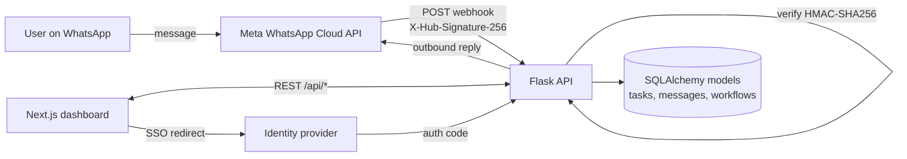

<div align="center">

# ClawdSap

**Text a task on WhatsApp. It shows up on your dashboard, scheduled and tracked.**

A full-stack personal task assistant built at a hackathon (Feb 2026) by a team of two.
I wrote the backend: the Flask API, the data model, the WhatsApp integration and the sign-on flow.


</div>

---

## What it does

You message the app in plain language, like *"remind me to call the bank at 5"* or *"every Monday, send me a summary"*. The backend receives the message through a WhatsApp webhook, turns it into a task or a recurring workflow, and the Next.js dashboard shows everything: tasks, message history, workflows, settings and billing.

## How it works



## My part: the backend

**REST API and data model.** Flask app with SQLAlchemy models for users, tasks, messages, workflows, user settings and billing (accounts and invoices), plus CRUD endpoints under `/api/` that the Next.js dashboard calls.

**Signed WhatsApp webhooks.** Every inbound webhook is checked against Meta's `X-Hub-Signature-256` header: the server recomputes an HMAC-SHA256 of the raw request body with the app secret and compares it with `hmac.compare_digest`, a constant-time comparison that doesn't leak timing information. Unsigned or tampered requests get a `401`. The `GET` handshake checks Meta's verify token before subscribing.

**Outbound messaging.** Replies go back through the WhatsApp Cloud API, with support for approved message templates.

**Single sign-on.** Authorization redirect, code exchange for tokens, and a user-info lookup that creates or links the local account. The redirect carries a `state` value that the callback checks against the session, and a PKCE code challenge (SHA-256 of a random verifier) so an intercepted code can't be exchanged by anyone else.

## API overview

| Area | Endpoints |
|---|---|
| Health | `GET /api/health` |
| Auth | login, signup, SSO start and callback |
| Tasks | list, create, update, delete |
| Messages | list, create |
| Workflows | list, create, update, delete |
| Settings and billing | get and update settings, get billing |
| WhatsApp | `GET /api/whatsapp/webhook` (verify), `POST /api/whatsapp/webhook` (receive) |

## Run it locally

```bash
git clone https://github.com/alexxaviers/ClawdSap.git
cd ClawdSap
cp backend/.env.example backend/.env   # fill in your own values
./run.sh                               # Flask on :5000, Next.js on :3000
```

`run.sh` creates the Python virtual environment, installs dependencies, starts both servers and stops them on Ctrl+C. WhatsApp features need your own Meta developer app; everything else runs without it.

## Project structure

```
backend/    Flask API: app.py (routes), models.py (SQLAlchemy), seed.py (demo data)
frontend/   Next.js + React + TypeScript dashboard (Tailwind, Radix UI, Recharts)
run.sh      Starts both servers
```

## Team

Built with [Aman Desai](https://github.com/amanpdesai) at a hackathon, February 2026.
